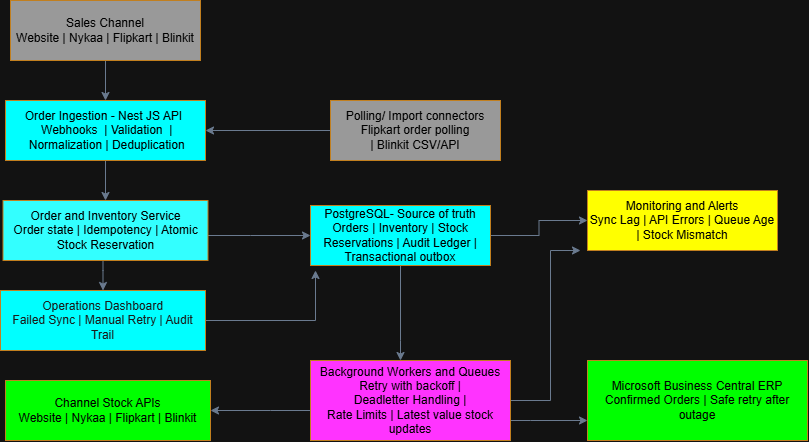

# Mars Cosmetics - Order & Inventory Sync Service

## 1. Overview
This design covers the Order & Inventory Sync Service for Mars Cosmetics. The service centralizes orders coming from four sales channels- our own website, Nykaa, Flipkart, and Blinkit and keeps sellable inventory in sync across all of them while pushing confirmed orders to Microsoft Business Central ERP.

The core backend uses Node.js (NestJS) for ingestion and business logic, PostgreSQL as the authoritative source of truth for stock and orders, and decoupled background workers to handle rate-limited channel stock updates and ERP syncs.

Our main engineering goals are simple:
1. Prevent overselling during high-volume sales events.
2. Handle duplicate and out-of-order channel webhooks safely.
3. Push stock changes to channels within 60 seconds under normal operations.
4. Guarantee no order loss when downstream systems (like the ERP) go down.

---

## 2. Assumptions
- **Source of Truth:** PostgreSQL holds the master inventory, active reservations, and audit trail.
- **External IDs:** Every channel provides a unique order ID we can rely on for deduplication.
- **API Reliability:** Downstream channel APIs will experience latency, rate limits, and transient outages.
- **ERP Downtime:** The ERP's weekly Sunday maintenance window (1-2 hours) is expected; confirmed orders must queue safely during this time.
- **Stock Updates:** Channel APIs accept absolute stock quantities (or allow us to reconcile toward a target number).
- **Ops Access:** Ops teams can trigger manual job retries through a dashboard, but nobody edits database inventory directly.
- **Budget & Stack Constraints:** Using AWS ECS Fargate, managed RDS PostgreSQL (`db.t3.medium`), and a small ElastiCache Redis instance keeps infra costs well under the rs 50,000/month limit for our 3-dev team shipping in 6 weeks.

---

## 3. Architecture and Deployment



### Core Components
1. **Ingestion Layer (NestJS API):** Exposes webhook endpoints for the Website, Nykaa, and Blinkit. Runs a scheduled cron worker to poll Flipkart orders every 2 minutes and parse Blinkit's daily CSV imports.
2. **Order & Inventory Engine:** Normalizes incoming payloads into a standard format, checks idempotency keys, and runs atomic stock reservation logic in PostgreSQL.
3. **PostgreSQL Database:** Primary datastore holding orders, line items, stock counts, reservations, immutable audit logs, and transactional outbox jobs.
4. **Background Workers:** Independent worker processes that read from the outbox table, calculate desired channel stock, respect per-channel rate limits, and push orders to the ERP.
5. **Redis:** Used exclusively for ephemeral coordination- specifically distributed locks and per-channel rate-limiting counters. It is **not** an authoritative stock store.
6. **Operations Dashboard & Observability:** Internal web UI allowing ops to inspect failed syncs, view audit trails, and trigger manual retries.

### Deployment Strategy
We deploy the NestJS API and the background workers as separate ECS services. This decouples ingestion from processing: if Nykaa or Business Central goes down, order webhooks still land and queue safely in PostgreSQL without dropping connections or failing upstream.

Workers run with worker-level concurrency bounds and rate limiters. Pending channel updates and ERP deliveries live in an `outbox` table inside PostgreSQL. If a process crashes or the ERP goes offline, jobs remain durable in the DB and resume automatically once workers restart.

---

## 4. Data Model and Constraints

| Table | Primary Fields | Purpose & Key Rules |
|---|---|---|
| `orders` | `id`, `channel`, `external_order_id`, `status`, `created_at` | Master order record. Unique constraint on `(channel, external_order_id)` blocks duplicate webhook ingestion. |
| `order_items` | `order_id`, `sku`, `quantity`, `unit_price` | Line items per order. |
| `inventory` | `sku`, `on_hand`, `reserved`, `updated_at` | Single row per SKU. Check constraint enforces `(on_hand - reserved) >= 0`. |
| `reservations` | `id`, `order_id`, `sku`, `quantity`, `status` | Active reservations tied to orders (`RESERVED`, `RELEASED`, `FULFILLED`). |
| `stock_audit` | `id`, `sku`, `old_qty`, `new_qty`, `reason`, `order_id`, `created_at` | Immutable ledger recording every single inventory adjustment. |
| `outbox` | `id`, `event_type`, `aggregate_id`, `payload`, `status`, `attempts`, `next_attempt_at` | Transactional outbox for async worker execution. |
| `channel_sync` | `id`, `sku`, `channel`, `desired_qty`, `last_synced_qty`, `status`, `last_error` | Tracks channel-specific sync state to prevent redundant API calls. |

### Handling Duplicates & Transaction Boundaries
We rely on database unique constraints as our ultimate safety net against duplicate orders. The entire order processing flow- inserting the normalized order, locking inventory, updating reservation counts, writing the audit entry, and appending outbox jobs- happens inside a single, explicit PostgreSQL transaction (`BEGIN ... COMMIT`).

If a customer cancels an order or initiates an eligible return, state transitions are guarded so stock is released back into `inventory` exactly once. Every release writes a corresponding `CANCELLATION_RELEASE` entry to `stock_audit`.

---

## 5. Order Processing & Concurrency

### Stock Reservation Logic
When an order comes in, the service normalizes the request and opens a PostgreSQL transaction. To prevent database deadlocks when multi-item orders arrive simultaneously, the system always sorts the order's SKUs alphabetically before acquiring locks.

Available sellable stock is calculated as: `available = on_hand - reserved`.

#### What happens when two channels buy the last unit at the exact same second?
1. **00:00.000** - Order A (Nykaa) and Order B (Website) arrive at the API at the same moment, both requesting the last unit of `MRS-LIP-104`.
2. **00:00.005** - Both API handlers start separate database transactions.
3. **00:00.010** - Transaction A runs `SELECT * FROM inventory WHERE sku = 'MRS-LIP-104' FOR UPDATE`. It acquires the row-level lock first.
4. **00:00.012** - Transaction B tries to run the same query on `MRS-LIP-104`. PostgreSQL pauses Transaction B, forcing it to wait for Transaction A to finish.
5. **00:00.020** - Transaction A checks stock (`1 on_hand - 0 reserved = 1 available`). Stock is sufficient. It increments `reserved` to `1`, inserts a reservation record, writes an audit row, enqueues an outbox job, commits, and releases the lock.
6. **00:00.022** - Transaction B wakes up and gets the lock. It evaluates stock: `1 on_hand - 1 reserved = 0 available`.
7. **00:00.025** - Transaction B detects zero available stock, aborts its transaction (`ROLLBACK`), marks the incoming order attempt as `REJECTED_OUT_OF_STOCK`, and alerts the ingestion workflow. 

Result: Exactly one order gets confirmed. Zero overselling.

### Reservation Code Pattern

```typescript
async function reserveStockAndIngestOrder(orderData: NormalizedOrder): Promise<OrderResult> {
  const queryRunner = this.dataSource.createQueryRunner();
  await queryRunner.connect();
  await queryRunner.startTransaction();

  try {
    // 1. Deduplicate via DB unique constraint
    const order = await queryRunner.manager.insert(OrderEntity, {
      channel: orderData.channel,
      externalOrderId: orderData.externalOrderId,
      status: 'RECEIVED',
    });

    // 2. Sort SKUs to prevent deadlocks across concurrent transactions
    const sortedItems = [...orderData.items].sort((a, b) => a.sku.localeCompare(b.sku));

    for (const item of sortedItems) {
      // 3. Row-level lock
      const inventory = await queryRunner.manager.findOne(InventoryEntity, {
        where: { sku: item.sku },
        lock: { mode: 'pessimistic_write' }, // SELECT ... FOR UPDATE
      });

      if (!inventory) throw new Error(`SKU ${item.sku} does not exist`);

      // 4. Verify stock availability
      const availableStock = inventory.on_hand - inventory.reserved;
      if (availableStock < item.quantity) {
        throw new OutOfStockException(`Insufficient stock for ${item.sku}`);
      }

      // 5. Update reservation count
      inventory.reserved += item.quantity;
      await queryRunner.manager.save(inventory);

      await queryRunner.manager.insert(ReservationEntity, {
        orderId: order.id,
        sku: item.sku,
        quantity: item.quantity,
        status: 'RESERVED',
      });

      // 6. Audit log entry
      await queryRunner.manager.insert(StockAuditEntity, {
        sku: item.sku,
        oldQty: availableStock,
        newQty: availableStock - item.quantity,
        reason: 'ORDER_RESERVATION',
        orderId: order.id,
      });
    }

    // 7. Write outbox jobs
    await queryRunner.manager.insert(OutboxEntity, [
      { eventType: 'STOCK_UPDATED', aggregateId: order.id, payload: { ... } },
      { eventType: 'ERP_DELIVERY_PENDING', aggregateId: order.id, payload: { ... } },
    ]);

    await queryRunner.manager.update(OrderEntity, order.id, { status: 'CONFIRMED' });
    await queryRunner.commitTransaction();
    return { success: true, orderId: order.id };

  } catch (error) {
    await queryRunner.rollbackTransaction();
    if (error instanceof OutOfStockException) {
      await this.handleInsufficientStock(orderData);
    }
    throw error;
  } finally {
    await queryRunner.release();
  }
}
```

---

## 6. Channel Synchronization & Outages

### Channel Rules & Rate Limits
1. **Website:** Direct API/DB integration. We push stock updates immediately.
2. **Nykaa:** REST API, 1 SKU per call, strictly capped at **5 req/sec**. Workers use token-bucket rate limiters in Redis.
3. **Flipkart:** Bulk REST API (up to 50 SKUs per request), capped at **10 req/sec**. Workers batch pending updates into groups of 50 SKUs to maximize throughput during peak traffic.
4. **Blinkit:** Unreliable REST API (~2% timeouts) and daily CSV uploads. For REST timeouts, workers retry setting the *absolute current stock* (e.g., set stock to `12`) rather than sending relative adjustments (`-2`), making retries safe and idempotent.

### Job Coalescing (Peak Load Handling)
During a flash sale, a popular SKU might sell 50 times in 10 seconds. Instead of pushing 50 individual stock updates to Nykaa (which would choke on the 5 req/sec rate limit), workers **coalesce** pending jobs.

Before firing an API call, the worker checks the `channel_sync` table for the latest `desired_qty` across all pending outbox jobs for that SKU and sends a single update with the newest total. This keeps channel stock accurate within our 60-second window without hitting API limits.

### ERP Downtime (Sunday Maintenance Window)
When Business Central goes down for its weekly maintenance:
- Webhooks continue accepting orders and reserving stock as normal.
- ERP worker jobs fail, catch the network/server error, and stay in `PENDING` status with exponential backoff.
- When the ERP comes back online, workers drain the queue without dropping any orders or creating duplicates (using `external_order_id` as the ERP idempotency key).

---

## 7. Observability & Operations

### Key Metrics & Alerts
- **Stock Sync Lag (Alert if > 60s):** Measures the time between a database inventory change and successful push to channel APIs.
- **Outbox Queue Backlog (Alert if pending jobs > 500 or oldest job > 5 min):** Detects worker crashes or downstream throttling.
- **Channel 429 / Timeout Rate (Alert on > 5% error rate over 5 min):** Detects rate limit breaches or channel outages.
- **ERP Queue Backlog:** Tracks pending order deliveries to Business Central during maintenance windows.

### Dashboard & Manual Operations
Operators use the internal dashboard to view failed outbox jobs, error stack traces, and the full audit log for any SKU. If a job permanently fails (e.g., an invalid SKU format), it moves to a `DEAD_LETTER` state. Ops can fix the underlying data and click "Retry"—which re-queues the existing job idempotently rather than creating a new business event.

---

## 8. Trade-offs

| Decision | Chosen Option | Rejected Option | Engineering Reason |
|---|---|---|---|
| **Stock Source of Truth** | PostgreSQL transactions + `FOR UPDATE` row locks | Redis in-memory counters | Redis is fast, but volatile. A Redis crash could lose reservation state and cause massive overselling. RDBMS row locks guarantee strict durability. |
| **Integration Pattern** | Transactional Outbox + Async Workers | Direct HTTP calls during webhook ingestion | Calling Nykaa or ERP directly inside the order webhook route causes long response times, cascades downstream failures, and loses orders if ERP is offline. |
| **Stock Sync Strategy** | Coalesced target state updates | Replaying every incremental change | Pushing every single -1 update quickly hits API rate limits during sales. Sending the coalesced absolute count stays under rate limits while keeping stock accurate. |

---

## 9. Version 1 Scope

### In Scope for v1
- Ingestion connectors for Website, Nykaa, Flipkart, and Blinkit.
- Atomic stock reservation and cancellation logic.
- Transactional outbox pattern with rate-limited background workers.
- Automated retries with backoff and dead-letter handling.
- Operations UI for sync monitoring and manual retries.

### Excluded from v1
- **Multi-warehouse routing:** All stock is assumed to ship from one central warehouse.
- **Predictive forecasting:** No automated reordering or demand prediction.
- **Replacing ERP/Channels:** We work within existing API constraints rather than altering third-party behavior.

---

## 10. Acceptance Criteria

1. **No Overselling:** Concurrent orders for the last available unit must never result in negative sellable stock or double bookings.
2. **Idempotency:** Replay of duplicate webhooks must return the original result without double-reserving stock or double-sending orders to the ERP.
3. **Resilience:** The system must handle a 2-hour ERP outage and 300 orders/minute peak sales volume without manual intervention or lost records.
4. **Auditability:** Every single stock change must have a corresponding row in `stock_audit` linking back to an order ID or manual adjustment reason.

---

## 11. AI Usage Note
AI tools were used to help clean up document structure and format code snippets; all technical architecture choices and data modeling decisions were authored and validated directly.

---

## 12. Stretch Goal: Ops Assistant (Natural Language Discrepancy Queries)

To help the ops team answer questions like *"Why did SKU X oversell yesterday?"*, we add an internal LLM tool using function calling.

- **Data Access:** Read-only access to `stock_audit`, `orders`, and `channel_sync` tables via predefined SQL templates.
- **Hallucination Prevention:** The LLM does not generate freeform database claims. Instead, it uses tool-calling to convert user input into structured parameters (SKU, date range), executes a deterministic `SELECT` query, and simply summarizes the returned database rows in plain text.
- **Estimated Cost:** Ops usage is light (~30-50 queries/day). Using lightweight models like `gpt-4o-mini` or `claude-3-haiku` costs roughly **$2 to $4/month** (~rs200-rs350/month), well within our overall operational budget.